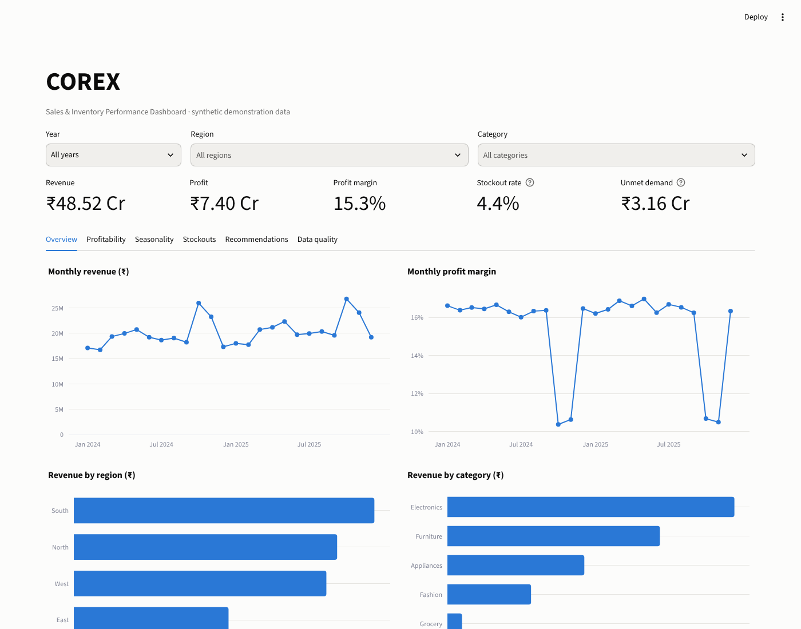
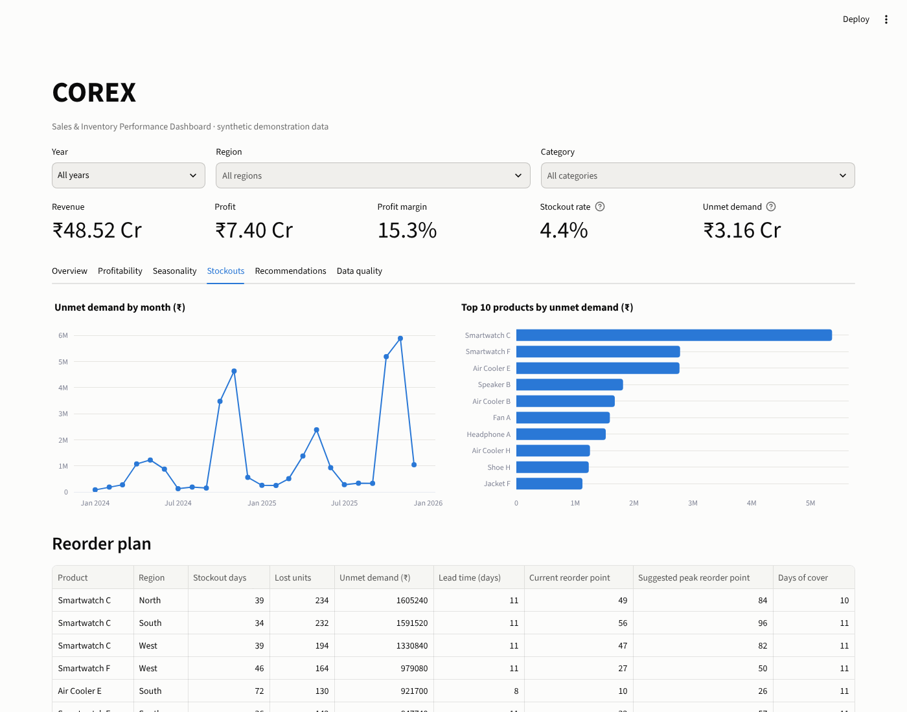

# COREX: Sales & Inventory Performance Dashboard

An end-to-end analytics project: messy retail data is cleaned in Python and turned into an interactive
dashboard for revenue, profit margin, seasonality, stockouts and improvement suggestions.

> **Data note:** the data is **synthetic** (generated by `src/generate_data.py`, seed 42), with patterns and
> quality problems deliberately built in. Results demonstrate the method, not a real business.




## Features
- **Cleaning pipeline:** removes duplicate orders, parses two date formats and text prices, standardises
  region/city names, handles missing discounts and categories, drops invalid quantities, writes a quality report.
- **Dashboard:** year, region and category filters; KPI cards with year-on-year change; margin by sub-category
  and discount band; seasonality heatmap; reorder plan with CSV download.
- **Recommendations:** rule-based, each with a stated assumption and an estimated rupee impact.

## Run locally (Python 3.12 or newer)
```bash
python -m venv .venv
# Windows:      .venv\Scripts\activate
# macOS/Linux:  source .venv/bin/activate
pip install -r requirements.txt
streamlit run dashboard.py
```
Open http://localhost:8501. Cleaned data is included. To rebuild it and run the tests:
```bash
python -m src.generate_data
python -m src.clean_data
pip install -r requirements-dev.txt
python -m pytest
```

## Deploy on Vercel
1. Push this folder to a GitHub repository. `app.py`, `vercel.json` and `data/processed/` must be at the repository root.
2. On vercel.com choose **Add New > Project** and import the repository.
3. Under **Environment Variables** add `VERCEL_SUPPORT_LARGE_FUNCTIONS` = `1`.
4. Click **Deploy**.

Notes:
- Large functions are a Vercel beta; the libraries exceed the standard size limit.
- WebSocket connections end at the function's maximum duration (300 s on Hobby). The page reconnects, but
  filters may reset.
- The first load after idle time can be slow.
- State and downloads live in one server instance, so they can occasionally fail if requests reach another.
- If this is a problem, Streamlit Community Cloud can host the same repo with `dashboard.py` as the main file.

## Structure
| Path | Purpose |
|---|---|
| `src/generate_data.py` | synthetic orders, products, regions, daily inventory |
| `src/clean_data.py` | cleaning, joins, revenue and profit |
| `src/metrics.py` | KPIs, seasonality, reorder points, recommendations |
| `dashboard.py` | Streamlit + Plotly interface |
| `app.py`, `vercel.json` | Vercel entry point and settings |

## Definitions
- Revenue = quantity × unit price × (1 − discount)
- Profit = revenue − product cost − shipping (no overheads, returns or tax)
- Stockout rate = share of product-region-days ending with zero stock
- Unmet demand = unavailable units × list price (known here only because the data is simulated)
- Reorder point = peak daily demand × lead time + 1.65 × σ × √lead time

## Limitations
Inventory is simulated before order-file errors are injected, so cleaned order units differ slightly from
inventory units sold. Impact estimates assume demand does not react to price or discount changes.
The suggested reorder points have not been back-tested.
